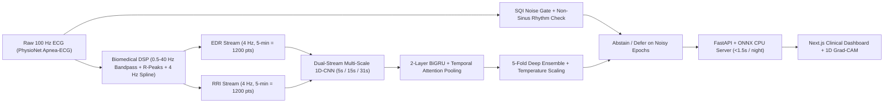

# CardioBreath — Technical Implementation Plan

**Single-Lead ECG Sleep Apnea Pre-Screening via Cardiopulmonary Coupling & Deep Sequence Modeling**

> Built for **AI for Medicine: A Global Student Hackathon on the Future of Care** (`ai-for-medicine.devpost.com` · Open Health AI Collective · Deadline: **Dec 4, 2026 @ 8:45 PM PST**).
>
> **Status:** Phases 1–3 implemented, Colab T4 5-fold training completed, locked held-out test set (`x01–x35`) evaluated, and all 27 automated tests + frontend production build verified on `main`. Ready for Hugging Face Spaces deployment and Devpost submission.

---

## 1. System Overview & Architecture

CardioBreath extracts hidden breathing modulation (**ECG-Derived Respiration, EDR**) and heart-rate coupling (**RR-Interval tachogram, RRI**) from raw 100 Hz single-lead overnight ECGs, scores every minute of sleep using a calibrated **5-fold Deep Ensemble of Dual-Stream Multi-Scale 1D-CNN + BiGRU** models guarded by a **Signal Quality Index (SQI) abstention gate**, and presents results in a zero-install **Next.js + FastAPI** clinical triage dashboard with live **1D Grad-CAM** explainability.



---

## 2. Core Engineering & Clinical Safeguards

1. **Strict Held-Out Test Lock (Tie-Breaker Rigor):**
   * The 35 official test nights (`x01–x35`, labels from Challenge 2000 `event-2-answers`) are isolated in `data/processed/test/`.
   * All DSP calibration, model selection, decision thresholds (`0.60`), and Temperature Scaling (`T = 1.835`) are fit strictly inside **5-fold subject-disjoint cross-validation** on the 35 learning nights (`a01–a20`, `b01–b05`, `c01–c10`).
   * The held-out test set is evaluated once via `python evaluate.py --split test --seed 42` after freezing architecture and hyperparameters.
2. **Clinical Honesty Baked Into Code & UI:**
   * Minute-level Apnea-ECG labels (`A`/`N`) measure **Estimated Apnea Burden (`eAHI`, apnea-minutes/hr)** rather than discrete PSG event-count AHI. Every UI card, chart, and report labels `eAHI (Estimated Apnea Burden)` and frames output strictly as **pre-screening triage**, never autonomous diagnosis.
   * A built-in **non-sinus / AFib irregularity check** flags erratic heart-rate variability nights where ECG-derived screening is unreliable.
   * Degraded or noisy minutes trigger the **SQI abstention gate** (amber *Deferred / Low Signal* in the UI) instead of hallucinating apnea predictions.
3. **Hybrid Compute & Zero-Install Deployment:**
   * All DSP preprocessing, unit tests, baselines, ONNX CPU inference, and Next.js + FastAPI serving run smoothly on a standard laptop CPU.
   * Full 5-fold training for `CardioBreathNet`, both baselines, and all 3 ablations runs in ~15–20 minutes on a free Google Colab T4 GPU via `notebooks/train_colab.ipynb`.
   * A single non-root Docker container (`Dockerfile`, port `7860`) builds the static Next.js frontend and serves both UI and FastAPI ONNX API together for one-repo **Hugging Face Spaces** hosting.

---

## 3. Module-by-Module Blueprint

### Module 1 — Repository Foundation & Reproducibility Configs
* `.gitignore` & `.gitattributes`: Ignores `.venv/`, `node_modules/`, `data/`, and heavy training checkpoints while keeping `artifacts/onnx/cardiobreath/*.onnx`, `artifacts/checkpoints/lgbm/*.txt` (locked with `-text` to prevent Windows CRLF byte-offset corruption), `artifacts/checkpoints/cardiobreath/fold_0.pt` (for live Grad-CAM), and `demo_data/`.
* `pyproject.toml`, `requirements.txt`, `requirements-dev.txt`: Pinned Python 3.11 runtime and dev/test dependencies (`numpy`, `scipy`, `pandas`, `scikit-learn`, `lightgbm`, `wfdb`, `neurokit2`, `torch`, `onnx`, `onnxruntime`, `matplotlib`, `seaborn`, `pyyaml`, `fastapi`, `uvicorn`, `python-multipart`, `tqdm`, `pytest`, `ruff`).
* `configs/default.yaml` & `src/config.py`: Single source of truth for all hyperparameters:
  * `seed: 42`, `sampling_rate_raw: 100 Hz`, `sampling_rate_dsp: 4 Hz`, `context_minutes: 5` (`window_len = 1200`).
  * DSP: `0.5–40.0 Hz` 4th-order zero-phase Butterworth bandpass, `0.08–0.60 Hz` EDR respiratory band, RR bounds `0.30–2.00 s` (`30–200 bpm`), local median outlier tolerance `±25%`, SQI thresholds (`sqi_pass_threshold: 0.65`, `afib_rmssd_ratio_threshold: 0.22`).
  * Model: `cnn_channels: 32`, multi-scale post-stem `cnn_kernels: [5, 15, 31]` (`~5s / ~15s / ~31s` cycles at 1 Hz effective post-stem rate), 2-layer BiGRU (`gru_hidden: 96`, `dropout: 0.30`), `lr: 1e-3`, `weight_decay: 1e-4`, `batch_size: 64`, `max_epochs: 35`, `early_stop_patience: 7`.
  * Clinical thresholds: `eAHI` cutoffs `5.0` (screening referral), `15.0` (moderate), `30.0` (severe); `fn_to_fp_cost_ratio: 5.0`; `1,000` subject-clustered bootstrap resamples; noise stress levels `[20, 10, 5, 0] dB`.
* `configs/folds.json`: Deterministic 5-fold subject-disjoint split over `a01–c10`, stratified so every validation fold has exactly **4 apnea (`a`), 1 borderline (`b`), and 2 normal (`c`)** subjects.

---

### Module 2 — PhysioNet Data Ingestion & Biomedical DSP Engine
* `scripts/download_data.py`: Parallel, resumable downloader using the PhysioNet AWS S3 open mirror (`physionet-open.s3.amazonaws.com`) with automatic `physionet.org` fallback and retry backoff. Downloads all 35 learning nights (`a01–c10`), 35 held-out test nights (`x01–x35`), 8 multi-sensor respiratory-belt recordings (`a01r–a04r`, `b01r`, `c01r–c03r`), and Challenge 2000 `event-2-answers.txt` (`17,268` test labels).
* `src/data_io.py`: Reads WFDB `.dat`/`.hea`/`.apn` files, parses `event-2-answers.txt` into minute-aligned label arrays, loads concurrent respiratory belt channels (`Resp C`, `Resp A`, `Resp N`, `SpO2`), and parses user-uploaded single-lead `.csv` ECGs for the web dashboard.
* `src/dsp.py`:
  1. `bandpass_ecg`: Zero-phase 4th-order Butterworth (`0.5–40 Hz`) via `scipy.signal.sosfiltfilt`.
  2. `detect_rpeaks_and_clean`: NeuroKit2 / Pan-Tompkins R-peak detection + physiological ectopic RR filter (`0.30–2.00 s` & `±25%` local median rejection with interpolation).
  3. `extract_edr_rri_4hz`: Extracts 4 Hz cubic-spline **RRI** tachogram and **EDR** respiratory envelope (`0.08–0.60 Hz`) with per-recording robust median/MAD z-score normalization (clipped at `±5σ`).
  4. `compute_minute_sqi_and_rhythm`: Per-minute **SQI `[0, 1]`** using multiplicative noise gating across valid-RR ratio, flatline/clipping checks, beat-template correlation, and clinical QRS (`5–30 Hz`) vs. EMG (`32–48 Hz`) band-power ratio, plus a recording-level non-sinus/AFib flag.
  5. `inject_motion_artifact`: Adds calibrated baseline wander + EMG burst artifacts at target SNR (`20, 10, 5, 0 dB`) for offline stress testing and the live UI stress-test toggle.
  6. `extract_hrv_features_per_minute`: Computes 22 classical HRV, EDR, and cardiopulmonary cross-spectral features per 5-minute window for Baseline 1.
* `scripts/preprocess.py`:
  * Caches all 70 nights into `data/processed/train/*.npz` (`17,023` min, `97.10%` mean SQI usable) and `data/processed/test/*.npz` (`17,248` min, `97.98%` mean SQI usable), containing `dual_windows (N, 2, 1200)`, `raw_1min (N, 1, 6000)`, `hrv_features (N, 22)`, `labels`, `sqi_score`, `sqi_pass`, and rhythm metadata.
  * Runs **8-Night Physical EDR Belt Validation** (`a01r–a04r`, `b01r`, `c01r–c03r`), saving `reports/edr_belt_validation.json` and `reports/figures/edr_belt_validation.png`.
  * Exports 4 compact held-out test nights into `demo_data/` spanning all clinical severity tiers: `x08` (Severe, `37.60/hr`), `x09` (Moderate, `19.76/hr`), `x21` (Mild/Borderline, `14.15/hr`), and `x04` (Normal, `0.00/hr`).

---

### Module 3 — Baselines, Deep Learning Core, Calibration & ONNX Export
* `src/datasets.py`: `ApneaWindowDataset` supporting 5 modes (`dual_5min`, `rri_only`, `edr_only`, `dual_1min`, `raw_1min`) with physiologically valid training-only augmentations (small amplitude scaling, mild Gaussian jitter, short time shift).
* `src/baselines.py`:
  * **Baseline 1 (`HRV + LightGBM`):** 5-fold subject-disjoint gradient-boosted trees on the 22 HRV+EDR+CPC features, with CRLF-safe `load_lgbm_boosters` for cross-platform Windows/Linux inference.
  * **Baseline 2 (`RawECGCNN` in `src/models.py`):** 4-block 1D-CNN operating directly on raw 1-minute 100 Hz ECG `(1, 6000)`.
* `src/models.py`:
  * **`CardioBreathNet`:** Separate lightweight stems for EDR and RRI (`1200 → 300`, 1 Hz effective rate) → parallel **Multi-Scale 1D-CNN** (`k = 5, 15, 31`) + Squeeze-and-Excitation channel attention → **2-layer Bidirectional GRU** (`hidden=96`, explicit dynamic-batch `h0` for clean ONNX export) → **Temporal Attention Pooling** → logit classifier.
  * **`compute_gradcam_1d`:** Hook-safe 1D Grad-CAM over the fused Multi-Scale CNN output, upsampled back to `1200` points (5 minutes @ 4 Hz).
* `src/calibration.py`: Out-of-fold L-BFGS-B **Temperature Scaling** (`T = 1.835`) and **5-fold Deep Ensemble** aggregation returning minute probabilities, epistemic std, and recording-level `eAHI` + **90% confidence intervals**.
* `train.py` & `notebooks/train_colab.ipynb`: Deterministic CLI (`--model all|cardiobreath|lgbm|raw_cnn|rri_only|edr_only|dual_1min`, `--seed 42`, `--smoke`) plus a turnkey Colab T4 notebook that trains all models, runs ONNX export + evaluation, and zips `cardiobreath_trained_artifacts.zip`.
* `scripts/export_onnx.py`: Exports all 5 `CardioBreathNet` folds to `artifacts/onnx/cardiobreath/fold_{0..4}.onnx` (`1.67 MB`/fold, verified `max_abs_diff <= 7e-7` vs. PyTorch) + dynamic INT8 quantized variants and CPU latency benchmarks.

---

### Module 4 — Clinical Evaluation Suite & Error Analysis
* `src/metrics.py`:
  * Per-minute AUROC, AUPRC, Accuracy, Sensitivity, Specificity, F1, ECE, and Brier Score with **1,000-resample subject-clustered bootstrap 95% CIs**.
  * Recording-level `eAHI` MAE, RMSE, Pearson *r*, **Bland-Altman bias & 95% LoA**, screening Sensitivity/Specificity at `eAHI >= 5` and `>= 15`, and **Decision Curve Analysis** (cost-weighted net benefit).
  * Un-gated vs. SQI-gated motion-noise robustness sweep across `clean, 20, 10, 5, 0 dB`.
* `evaluate.py`: Single-command evaluator (`python evaluate.py --split val|test --seed 42`) generating `reports/metrics_summary_<split>.json`, `reports/benchmark_table_<split>.md`, and publication figures in `reports/figures/`:
  * `roc_pr_curves_<split>.png`
  * `bland_altman_eahi_<split>.png`
  * `calibration_reliability_<split>.png`
  * `noise_robustness_sqi_<split>.png`
  * `edr_belt_validation.png`
  * `failure_cases_<split>.png` (automatically inspects held-out worst false-negative night and highest-confidence false-positive epoch)

---

### Module 5 — FastAPI Inference Backend
* `backend/app/schemas.py`: Strict Pydantic v2 contracts for case listings, full-night analysis, 5-minute window inspection, CSV uploads, and benchmark reporting.
* `backend/app/inference.py`: Thread-safe inference engine (`threading.Lock`) preloading all 5 ONNX fold sessions, LightGBM baseline boosters, and `fold_0.pt` (for on-demand CPU 1D Grad-CAM) with an in-memory LRU cache.
* `backend/app/main.py`: REST API + static mounting of built Next.js frontend (`frontend/out` at `/`) and evaluation figures (`/api/figures`):
  * `GET /api/health`
  * `GET /api/cases`
  * `POST /api/analyze/case/{case_id}` (supports `inject_noise_snr_db`, `threshold`, `compare_baseline`)
  * `POST /api/analyze/window` (returns synced 5-minute `ecg`, `edr`, `rri`, and `gradcam_saliency`)
  * `POST /api/analyze/upload` (accepts single-lead `.csv` ECG for live end-to-end screening)
  * `GET /api/evaluation` (serves locked `reports/metrics_summary_test.json`)

---

### Module 6 — Next.js Clinical Dashboard, Brand Identity & Container Packaging
* `frontend/public/logo.svg` & `frontend/public/logo-dark.svg`: Custom vector logo (ECG QRS morphing into a sinusoidal respiratory wave in surgical teal `#0D9488`, deep navy `#0F2942`, and coral `#E11D48`).
* `frontend/` (Next.js 15 App Router static export `output: "export"`, TypeScript, Tailwind CSS, `lucide-react`, custom high-FPS SVG clinical waveform charts):
  * `Navbar.tsx`: Brand header, held-out case picker (`x08`, `x09`, `x21`, `x04`), `.csv` upload modal, motion-noise stress-test SNR selector, clinician sensitivity threshold slider, and tab switch (`Clinical Triage` / `Research & Honesty`).
  * `TriageSummaryPanel.tsx`: `eAHI` + 90% CI triage card with severity badge, CPU latency, explicit pre-screening disclaimer, SQI & non-sinus rhythm honesty card, and live CardioBreath vs. HRV+LightGBM comparison card.
  * `FullNightTimeline.tsx`: Interactive 8-hour minute-by-minute timeline (Green = Normal, Coral = Apnea, Amber = Low SQI Deferred) with click-to-inspect navigation.
  * `SignalInspector.tsx`: Synchronized 3-track 5-minute viewer (Raw ECG, Extracted EDR, RRI Tachogram) overlaid with a coral **1D Grad-CAM** saliency band.
  * `ResearchBenchmarkView.tsx`: Displays locked `x01–x35` benchmark metrics, generated evaluation plots, *"Who Benefits / Who Could Be Harmed"*, and failure-case analysis.
* `Dockerfile` & `docker-compose.yml`: Multi-stage build (Node 20 builds `frontend/out` → Python 3.11-slim non-root container runs `uvicorn` on port `7860`) ready for **Hugging Face Spaces (Docker SDK)**.

---

### Module 7 — Automated Test Suite
* `tests/test_data_splits.py`: Guarantees zero subject leakage across all 5 CV folds and zero overlap with held-out `x01–x35`.
* `tests/test_dsp.py`: Verifies bandpass response, synthetic respiratory-modulated ECG → EDR correlation `r > 0.80`, and SQI rejection of flatlines and severe motion/EMG bursts.
* `tests/test_models.py`: Verifies forward passes across all model/ablation modes, finite `[0, 1]` Grad-CAM output, dynamic-batch ONNX parity (`< 1e-4`), and Temperature Scaling NLL improvement.
* `tests/test_metrics.py`: Verifies SQI-aware `eAHI` edge cases and valid subject-clustered bootstrap CI ordering.
* `tests/test_api.py`: Verifies FastAPI routes, Pydantic contracts, clean & noise-injected case analysis, window Grad-CAM inspection, and synthetic `.csv` ECG upload.

---

## 4. Verified Results Summary (Locked Held-Out Test `x01–x35`)

### Physical EDR Validation (8 Multi-Sensor Nights)
* **0.94 breaths/min MAE** against physical `Resp C` respiratory belts (`0.00 bpm` exact match on `a03`, `b01`, `c02`, `c03`), with **0.705** mean best-60s waveform correlation.

### Locked Held-Out Test Benchmark (`35 Unseen Nights`, `17,248 Minutes`, `seed=42`)

| Model | AUROC (95% CI) | AUPRC | Accuracy | Sens | Spec | F1 | eAHI MAE (/hr) | Pearson *r* | Screen Sens (`>=5`) | ECE |
| :--- | :---: | :---: | :---: | :---: | :---: | :---: | :---: | :---: | :---: | :---: |
| **Baseline 1: HRV + LightGBM** | 0.909 [0.879, 0.936] | 0.853 | 0.790 | 0.914 | 0.712 | 0.770 | 10.33 [7.70, 13.39] | 0.863 | 1.000 | 0.089 |
| **Baseline 2: Raw 1-min ECG CNN** | 0.777 [0.663, 0.869] | 0.727 | 0.685 | 0.718 | 0.664 | 0.637 | 17.81 [12.87, 23.19] | 0.372 | 0.957 | 0.144 |
| **Ablation A: RRI-Only (5-min)** | 0.965 [0.947, 0.978] | 0.951 | 0.902 | 0.904 | 0.901 | 0.876 | 3.97 [2.81, 5.33] | 0.963 | 1.000 | 0.064 |
| **Ablation B: EDR-Only (5-min)** | 0.900 [0.850, 0.938] | 0.878 | 0.832 | 0.774 | 0.868 | 0.779 | 6.53 [4.24, 8.88] | 0.876 | 0.957 | 0.048 |
| **Ablation C: Dual-Stream (1-min)** | 0.931 [0.905, 0.955] | 0.894 | 0.851 | 0.869 | 0.839 | 0.817 | 5.61 [3.92, 7.51] | 0.933 | 1.000 | 0.100 |
| **CardioBreath (Dual-Stream 5-Fold)** | **0.973 [0.961, 0.982]** | **0.958** | **0.909** | 0.832 | **0.958** | **0.876** | **3.27 [1.75, 5.01]** | **0.965** | **1.000** | **0.052** |

---

## 5. Verification & Local Run Commands

### Automated Verification (Already Passing)
```bash
# Python test suite (27/27 tests passing) + lint (0 errors)
pytest tests/ -v
ruff check src scripts backend tests train.py evaluate.py

# Frontend production static export
cd frontend && npm install && npm run build
```

### Run Full Dashboard Locally (Single Server on Port 7860)
```bash
# After running `cd frontend && npm run build`:
uvicorn backend.app.main:app --host 127.0.0.1 --port 7860
# Open http://127.0.0.1:7860
```

### Remaining Team Launch Checklist
1. **Deploy Live App:** Push `main` to a public **Hugging Face Space (Docker SDK, port 7860)** and verify live URL load, noise stress-test toggle, Grad-CAM click-through, and `.csv` upload.
2. **Record 2-Minute Demo Video:** Show live app immediately in `0:00–1:00` (`x08` full-night triage → Grad-CAM 3-track zoom → motion-noise SQI abstention → HRV+LightGBM baseline comparison), then locked `x01–x35` results & honest clinical limitations in `1:00–2:00`.
3. **Submit on Devpost (before Dec 4, 2026 @ 8:45 PM PST):** Upload logo (`frontend/public/logo.svg`), live HF Spaces URL, GitHub repo link, 2-min demo video, benchmark summary, clinical honesty section, and AI-tool disclosure.
